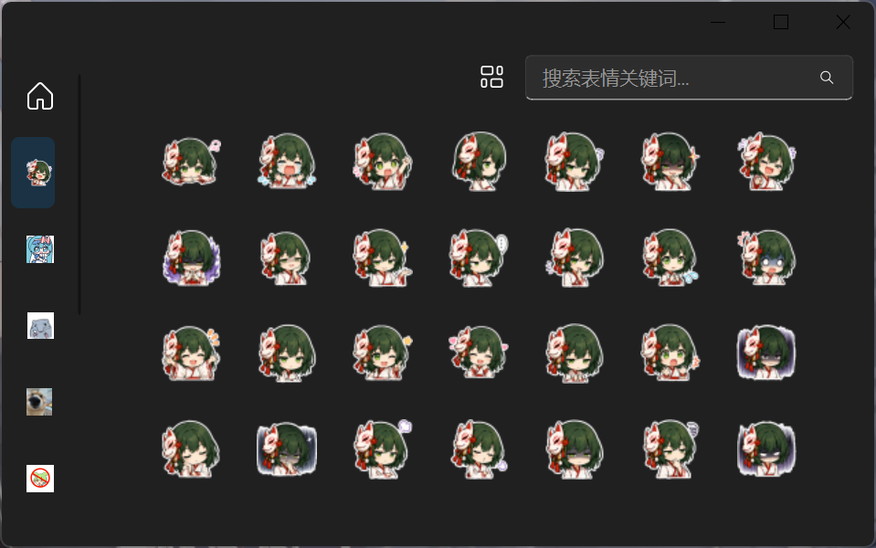
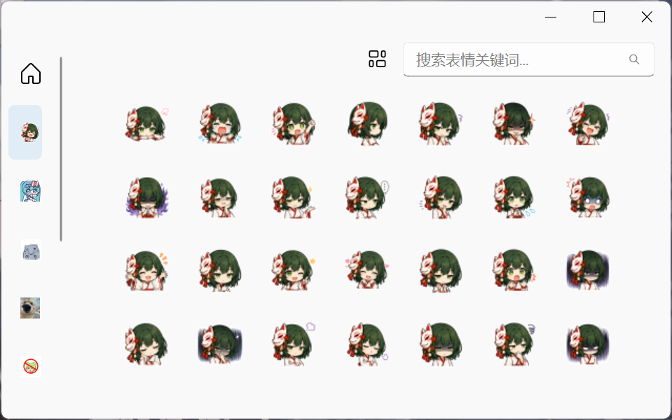
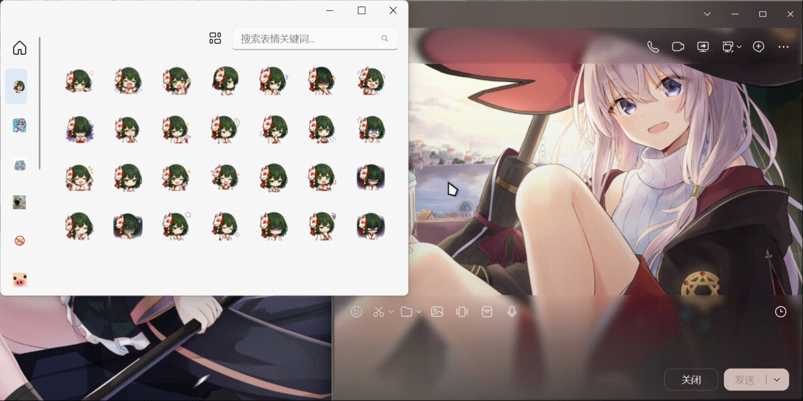
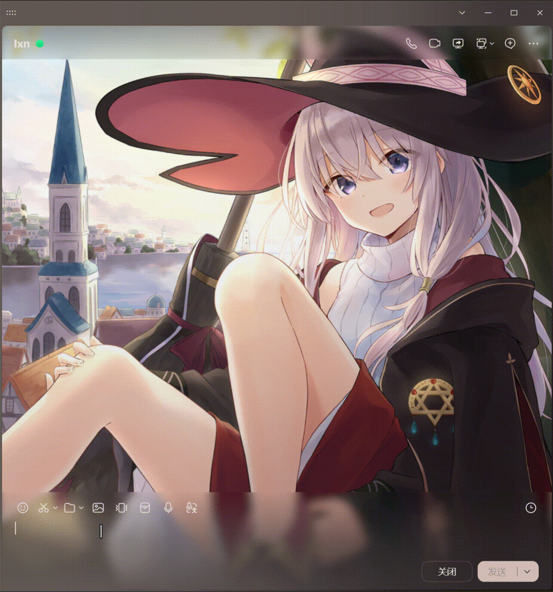
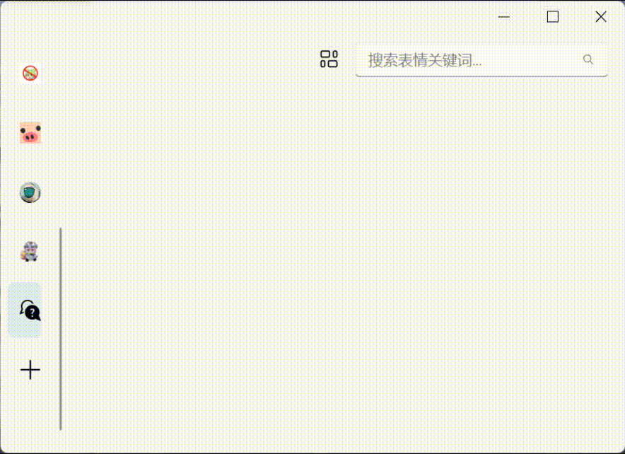
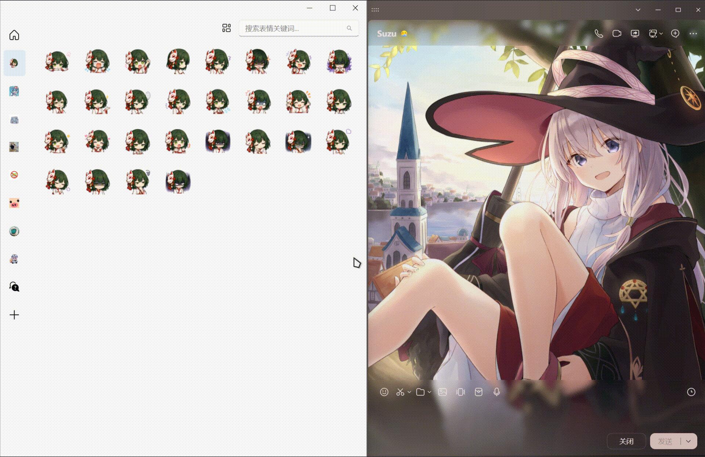
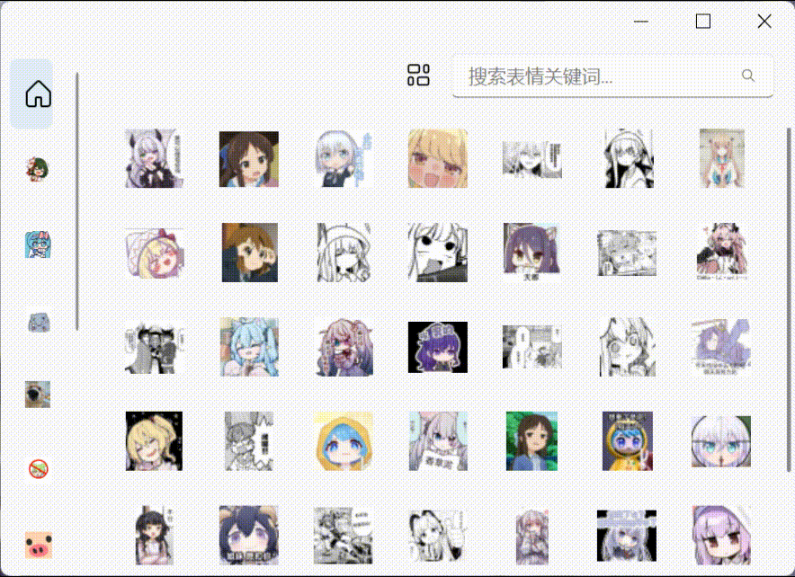

# 🥟 SuzuEmojy

<p align="center">
  
  
  <a href="LICENSE"></a>
  <a href="https://github.com/IxinorTyan/SuzuEmojy/releases"></a>
</p>

<p align="center">
  <a href="#-suzuemojy-cn"><b>简体中文</b></a> | <a href="#-suzuemojy-en"><b>English</b></a>
</p>

---

<span id="-suzuemojy-cn"></span>

## 🥟 SuzuEmojy (简体中文)

> **专为 Windows 打造的本地表情包管理利器**  
> 快速搜索、智能整理、一键发送，让收藏多年的表情包真正用起来。

当前分支是 Windows 2.x（WPF），解压即用，不依赖 Python 或 Qt。见 [前端说明](docs/windows-native-frontend.md) 和 [本地封包](docs/windows-packaging.md)。下方部分演示图片来自 1.x；旧版源码在对应的 Git 标签。

💬 **QQ 交流群**：`834586488`（欢迎进群交流心得、反馈 Bug、催更以及分享好看好玩的表情包！）

<p align="center">
  
  
</p>

### 💡 为什么会有 SuzuEmojy？

平时聊天软件里的表情包越来越多，几百张、几千张图片散落在各个硬盘文件夹里。每次想找一张应景的图都要翻找半天；浏览器里的图片不好直接保存；下载下来的 WebP/WebM 动图拖进聊天框又经常变成文件无法发送……

最主要的是，开发者常年多账号切换使用，但平台账号间的表情包互不相通，用起来十分折磨，于是在电脑本地存了巨量的表情。为了彻底解决这些困扰，让表情包管理变得轻松优雅，SuzuEmojy 应运而生。

<p align="center">
  
</p>

---

### ✨ 核心功能

#### ⌨️ 全局快捷呼出，即点即发
- **主面板快速呼出**：无论当前在使用什么软件，按下全局快捷键（默认 `Ctrl + Shift + E`，可在设置中自定义）即可秒速唤起表情面板。选择表情后自动粘贴回原聊天窗口（如遇焦点切换问题，表情也已保存在剪切板中，随时可 `Ctrl + V`）。
- **极速快捷窗口 (Quick Panel)**：按下快捷键（默认 `Ctrl + Shift + D` / `Alt + 2`，可自定义）快速唤出迷你面板，支持对打过 Tag 关键词的表情实时速搜，并按时间顺序列出最近使用的表情（默认展示 30 个，可在设置中自定义 1~999）。

<p align="center">
  
</p>

<p align="center">
  
</p>

#### 🚀 极速导入，丝滑流畅
- **海量图库无感加载**：即使一次性导入上千张图片，界面依然流畅丝滑，无需等待漫长的全部加载。
- **智能文件夹建类**：支持直接把整理好的本地文件夹拖入主界面，程序将自动创建同名分类夹并完成归类。

<p align="center">
  
</p>

<p align="center">
  
</p>

#### 🔍 实时标签搜索，比翻文件夹快得多
- 支持为表情添加自定义关键词与标签（Tag），边输边搜，毫秒级实时过滤。
- 告别漫无目的的翻找，真正做到“想找什么立刻找到”。

<p align="center">
  
</p>

#### 📂 自由整理与批量操作
- **自由拖拽**：支持在图库内直接拖动图片自定义排序，拖拽图片至左侧分类夹快速分类。
- **批量处理**：支持多选进行批量删除、批量导出、批量添加到子分类夹或移出分类夹。
- **上传图片辅助**：在主图库右键表情，选择“在资源管理器中显示”可打开文件夹并选中图片；选择“复制文件路径”后，可将路径粘贴到平台上传窗口的“文件名”栏。

<p align="center">
  
</p>

#### 📥 全网扒图与格式自动转码
- **剪贴板一键收藏**：网页或聊天软件中复制图片后，在主界面直接粘贴导入（注：部分平台如 B 站评论区动图需点击放大加载后复制）。
- **复制 URL 下载**：支持复制网络图片直链自动尝试下载。
- **格式自动转码**：许多网页动图（WebP、WebM）直接拖入聊天软件会变成文件发送。SuzuEmojy 支持自动重新编码转为正规图片；另存为到程序目录下的 `data/inbox` 文件夹也能自动触发监听转换并导入。

<p align="center">
  
</p>

<p align="center">
  
</p>

<p align="center">
  
</p>

#### 🛠️ 丰富的高级工具集
- **QQ 本地表情扫描**：一键扫描并提取本地 QQNT 客户端缓存与收藏表情。
- **Telegram 贴纸包下载**：支持解析与批量下载 TG 贴纸包，自动将 `.tgs` / `.webm` 等格式转码为常用动图与图片。
- **智能查重与去重**：基于图像特征感知算法，自动识别并清理重复或高度相似的表情包。
- **表情包导入与导出**：支持打包导出分享包，更换电脑或与好友分享一键搞定。

#### ✨ Fluent Design 与交互细节
- **现代美观 UI**：支持 Windows 11 云母（Mica）磨砂半透明特效，完美支持日间/夜间深浅主题自适应。
- **缩略图平滑缩放**：按住 `Ctrl + 鼠标滚轮` 可无级缩放表情卡片大小。
- **高清悬停预览**：鼠标悬停在表情卡片上超过指定时间（可在设置中调节），自动弹出高清动图浮层。
- **侧边栏双模式**：双击侧边栏“全部表情”可在“列表模式”与“网格模式”之间自由切换。
- **数据完全本地化**：零隐私泄露风险，所有数据和图片均保存在程序自身的 `data` 目录下，换机迁移只需完整复制 `data` 文件夹。

---

### ⌨️ 常用快捷键与操作速查

| 操作 / 快捷键 | 功能说明 | 备注 |
| :--- | :--- | :--- |
| `Ctrl + Shift + E` | 呼出 / 隐藏表情主面板 | 默认快捷键，可在“设置”中自定义 |
| `Ctrl + Shift + D` / `Alt + 2` | 唤出迷你快捷搜索窗口 (Quick Panel) | 默认快捷键，可在“设置”中自定义 |
| `Ctrl + 鼠标滚轮` | 缩放表情卡片 / 缩略图大小 | 支持平滑无级缩放 |
| `双击 "全部表情"` | 切换侧边栏展示形态 | 在“列表模式”与“网格卡片模式”间切换 |
| `鼠标悬停表情` | 弹出高清动图预览窗口 | 悬停触发延迟可在“设置”中自定义 |

---

### 📥 下载与安装

1. 从 [GitHub Releases](https://github.com/IxinorTyan/SuzuEmojy/releases) 下载 Windows 2.x 的 `system-runtime.zip`，尚无 2.x 版本时可按下文自行封包。
2. 解压后运行外层的 `SuzuEmojy.exe`。新版不自动下载运行库。
3. 换电脑或从旧版迁移时，退出软件后复制完整的 `data` 文件夹。详见 [图库迁移说明](docs/windows-packaging.md#使用已经封好的-zip)。

---

### 🥟 关于默认表情包

**Suzu** 是本项目的吉祥物和 1.x 的预置表情包。Windows 2.x 便携包不自带图库；可从旧图库迁移或自行导入。

---

### 💻 开发者指南

双击仓库根目录的 [`build_windows.bat`](build_windows.bat) 按项目版本号自动封包。首次构建的工具链、手动参数和 Release 附件见 [Windows 封包说明](docs/windows-packaging.md)。源码运行和测试见 [Windows 前端说明](docs/windows-native-frontend.md)。

---

### 📁 目录结构

```text
SuzuEmojy/
├── build_windows.bat     # 双击封包
├── build_windows.ps1     # 封包实现
├── win_frontend/         # 原生界面和业务逻辑
├── win_frontend_tests/   # 原生回归测试
├── win_launcher/         # 便携启动器
├── win_updater/          # Windows 2.x 更新器
└── scripts/              # 原生依赖构建工具
```

---

### 🤝 交流与反馈

- 💬 **QQ 交流群**：**`834586488`**（欢迎加入交流使用心得、反馈 Bug、提出新功能建议或分享好玩的表情包）
- 🐛 **Issue 反馈**：欢迎在 [GitHub Issues](https://github.com/IxinorTyan/SuzuEmojy/issues) 提交使用中遇到的问题和新功能建议。
- 💡 **PR 贡献**：非常欢迎提交 Pull Request，一起让 SuzuEmojy 变得更好！

---

### 🙏 致谢与鸣谢

本项目在开发过程中，参考与借鉴了以下优秀开源项目的思路与技术实现，在此向原作者们致以衷心的感谢：

- **[QQFavoriteExtract](https://github.com/VanillaNahida/QQFavoriteExtract)** (by [VanillaNahida](https://github.com/VanillaNahida))：为本项目的 QQNT 本地表情扫描、数据解析与提取导出功能提供了重要的实现思路与参考。
- **[tg_sticker_downloader](https://github.com/Kiowx/tg_sticker_downloader)** (by [Kiowx](https://github.com/Kiowx))：为本项目的 Telegram 贴纸包解析、下载与转码处理功能提供了宝贵的技术借鉴。

#### ⚠️ 合规与正确使用声明
1. **仅供个人学习与备份**：本项目提供的 QQ 表情扫描与 Telegram 贴纸下载等功能，仅用于用户对自己合法拥有或授权的表情数据进行本地备份、整理与学习交流。
2. **遵守相关法规与平台规范**：请在遵守相关法律法规及对应平台服务条款的前提下使用本软件。
3. **尊重原创版权**：表情包与贴纸资源的著作权及知识产权归原作者所有，请勿将获取的资源用于任何未经授权的商业用途或侵权传播。用户需自行承担因不当或违规使用而产生的法律责任。

---

### 📄 许可证

本项目基于 [GNU General Public License v3.0 (GPL-3.0)](LICENSE) 协议开源。

---

<span id="-suzuemojy-en"></span>

## 🥟 SuzuEmojy (English)

[Back to Chinese version (返回中文版)](#-suzuemojy-cn)

> **A local meme and emoji sticker manager focused on Windows**  
> Fast search, categorized organization, and one-click sending—making your meme collection of years truly useful.

<p align="center">
  
  
</p>

### 💡 Why SuzuEmojy?

Stickers and memes in chat applications keep increasing. Hundreds or thousands of pictures are scattered across various folders. Every time you want to find a picture, you have to spend a long time searching. Images on web browsers are difficult to save directly, and downloaded WebP/WebM files often turn into file attachments rather than stickers when dragged into chat windows.

Most importantly, the developer constantly switches between multiple accounts, but sticker collections cannot be shared across accounts. As a result, huge numbers of memes were stored locally on the PC. SuzuEmojy was born to solve all these troubles and make meme management effortless and pleasant.

<p align="center">
  
</p>

---

### ✨ Features

#### ⌨️ Global Hotkey Callout & One-Click Send
- **Main Window Callout**: No matter what software you are currently using, press the global hotkey (default: `Ctrl + Shift + E`, customizable) to immediately open the emoji panel. Selecting an image automatically pastes it into your previous chat window (if focus is lost, the sticker remains safely copied to your clipboard ready for `Ctrl + V`).
- **Quick Search Panel (Quick Box)**: Press the hotkey (default: `Ctrl + Shift + D` / `Alt + 2`, customizable) to quickly summon a mini search bar. Instantly search emojis that have keywords/tags, and view recently used emojis sorted chronologically (default: 30, customizable: 1–999).

<p align="center">
  
</p>

<p align="center">
  
</p>

#### 🚀 Fast Import & Smooth Browsing
- **Smooth Massive Loading**: Even when importing thousands of images, the interface remains smooth and responsive without sluggishness.
- **Smart Folder Categorization**: Directly drag categorized folders into the window; SuzuEmojy will automatically create matching categories and import images.

<p align="center">
  
</p>

<p align="center">
  
</p>

#### 🔍 Real-Time Tag Search
- Add custom keywords and tags to your memes for instant real-time filtering as you type.
- Truly find whatever you want right away without browsing through folders.

<p align="center">
  
</p>

#### 📂 Flexible Organization & Batch Operations
- **Drag-and-Drop Sorting**: Drag memes to customize order, or drag them directly into sidebar categories to reorganize.
- **Batch Management**: Multi-select support for batch deletion, batch export, and batch moving between categories.
- **Upload Helpers**: Right-click a sticker in the main gallery and choose "Show in File Explorer" to open its folder with the image selected, or "Copy file path" to paste its path into an upload dialog's "File name" field.

<p align="center">
  
</p>

#### 📥 One-Click Web Capture & Format Auto Re-Encoding
- **Clipboard Import**: Copy images from web pages or chat apps and paste them directly into SuzuEmojy (Note: animated images in Bilibili comments only load when clicked, so expand them before copying).
- **URL Download**: Copy image URLs to automatically download and parse them.
- **Format Conversion**: Many web images (WebP, WebM) turn into raw file attachments in chat apps. SuzuEmojy automatically re-encodes them so they function properly as sticker images; saving files directly into `data/inbox` will also trigger automatic conversion and import.

<p align="center">
  
</p>

<p align="center">
  
</p>

<p align="center">
  
</p>

#### 🛠️ Advanced Toolset
- **QQ Local Emoji Scanner**: Scan and extract cached and favorited emojis directly from local QQNT client data.
- **Telegram Sticker Pack Downloader**: Easily parse and batch download Telegram sticker packs, with automatic conversion for `.tgs` and `.webm` formats.
- **Smart Duplicate Detection**: Feature-aware perceptual hashing algorithms identify and clean duplicate or near-identical memes.
- **Emoji Pack Import & Export**: Export categories into standalone exchange packages for easy sharing or migration.

#### ✨ Modern Fluent Design & Interaction Details
- **Windows 11 Mica Styling**: Elegant translucent Mica visual effects with native Light and Dark theme adaptation.
- **Smooth Thumbnail Zooming**: Hold `Ctrl + Mouse Wheel` to smoothly zoom sticker card sizes.
- **HD Hover Preview**: Hover over any sticker card to display a high-resolution floating preview with instant animated playback.
- **Dual Sidebar Layout**: Double-click "All Emojis" in the sidebar to toggle between "List Mode" and "Grid Card Mode".
- **100% Local Storage**: Zero cloud upload and no privacy concerns. All data is saved in the local `data/` folder; migrating to another PC is as simple as copying the folder.

---

### ⌨️ Common Shortcuts & Interactions

| Action / Shortcut | Description | Notes |
| :--- | :--- | :--- |
| `Ctrl + Shift + E` | Summon / Hide main emoji panel | Default shortcut, customizable in Settings |
| `Ctrl + Shift + D` / `Alt + 2` | Summon mini quick search panel (Quick Box) | Default shortcut, customizable in Settings |
| `Ctrl + Mouse Wheel` | Smoothly zoom emoji card thumbnails | Works in both gallery and sidebar grid mode |
| `Double click "All Emojis"` | Switch sidebar between List Mode and Grid Mode | Toggle whenever you want |
| `Hover over sticker` | Floating high-resolution / animation preview | Hover delay can be customized in Settings |

---

### 📥 Download & Getting Started

1. Download the Windows 2.x `system-runtime.zip` from [GitHub Releases](https://github.com/IxinorTyan/SuzuEmojy/releases), or build it below if a 2.x release is not available.
2. Extract the archive and run the outer `SuzuEmojy.exe`. It does not download a runtime.
3. Close the application before copying the full `data/` folder to another PC or upgrading. Legacy 1.x source is available from its Git tags.

---

### 🥟 About Default Emoji Pack

**Suzu** is the mascot and the default sticker pack from 1.x. The Windows 2.x portable ZIP does not include a gallery; migrate an existing one or import your own stickers.

---

### 💻 Developer Guide

Double-click [`build_windows.bat`](build_windows.bat) to build a package using the project version. See the [Windows packaging guide](docs/windows-packaging.md) for build prerequisites, command-line options and release assets, and the [frontend guide](docs/windows-native-frontend.md) for development and tests.

---

### 📁 Project Structure

```text
SuzuEmojy/
├── build_windows.bat     # Double-click to build a ZIP
├── build_windows.ps1     # Packaging implementation
├── win_frontend/         # Native UI and application logic
├── win_frontend_tests/   # Native regression tests
├── win_launcher/         # Portable launcher
├── win_updater/          # Windows 2.x updater
└── scripts/              # Native dependency build tools
```

---

### 🤝 Contribution & Feedback

- 🐛 **Submit Issues**: Bug reports and feature suggestions are welcome on [GitHub Issues](https://github.com/IxinorTyan/SuzuEmojy/issues).
- 💡 **Pull Requests**: Contributions and improvements are warmly appreciated!

---

### 🙏 Acknowledgments

During development, we referenced and learned from the ideas and implementations of the following excellent open-source projects. We express our sincere gratitude to their authors:

- **[QQFavoriteExtract](https://github.com/VanillaNahida/QQFavoriteExtract)** (by [VanillaNahida](https://github.com/VanillaNahida)): Provided great inspiration and references for local QQNT emoji scanning, parsing, and extraction workflows.
- **[tg_sticker_downloader](https://github.com/Kiowx/tg_sticker_downloader)** (by [Kiowx](https://github.com/Kiowx)): Provided valuable technical inspiration for Telegram sticker pack parsing, downloading, and conversion.

#### ⚠️ Fair Use & Compliance Statement
1. **Personal Backup & Learning Only**: The emoji scanning and sticker downloading features in this project are strictly intended for users to backup, organize, and manage their own legitimately accessed emoji/sticker assets locally for personal study.
2. **Platform & Legal Compliance**: Please use this software in full compliance with applicable laws, regulations, and platform Terms of Service.
3. **Respect Intellectual Property**: The copyright and intellectual property rights of all stickers, memes, and artwork belong to their original creators. Do not use acquired assets for unauthorized commercial purposes or infringing redistribution. Users are solely responsible for any misuse.

---

### 📄 License

This project is licensed under the [GNU General Public License v3.0 (GPL-3.0)](LICENSE).
